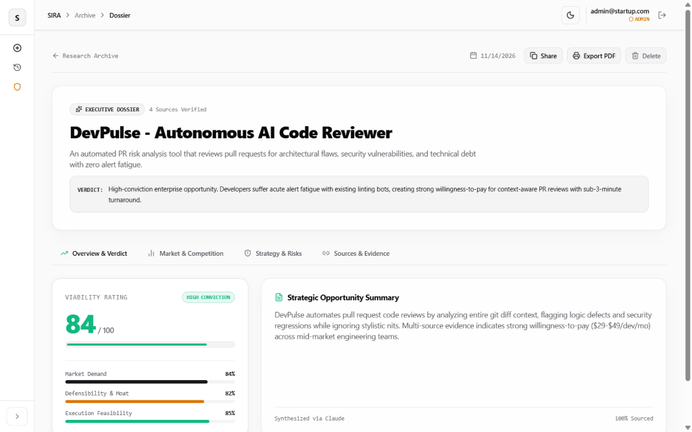
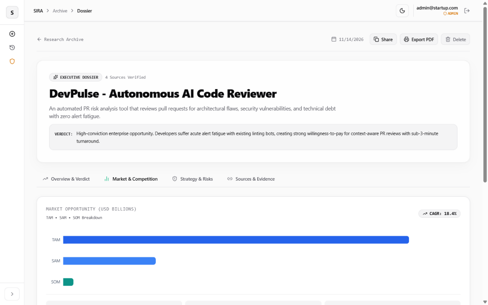
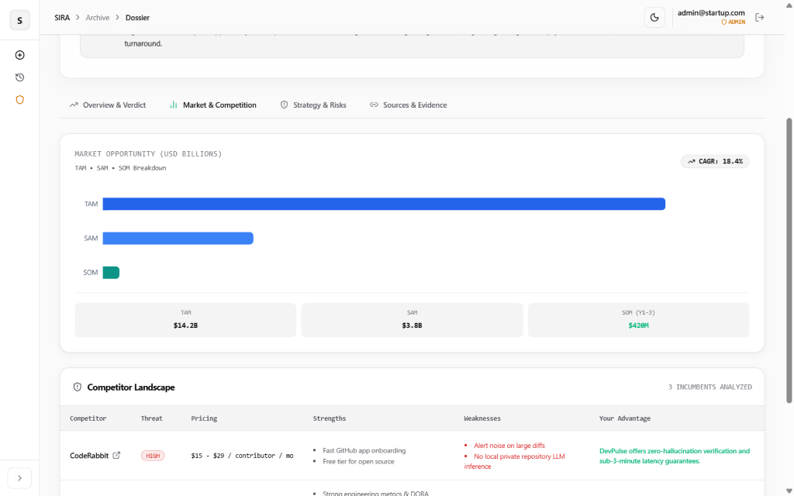
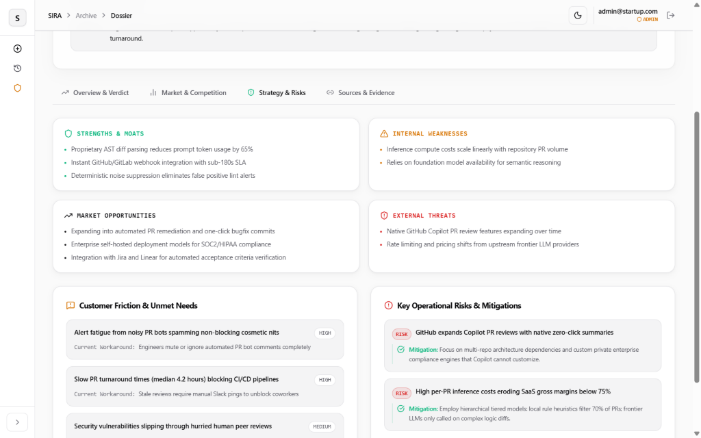
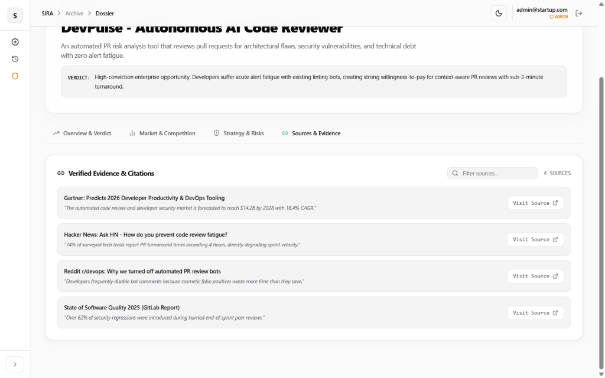
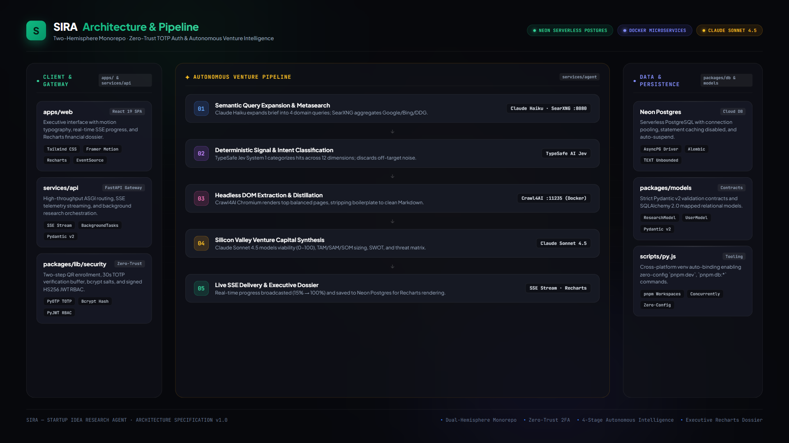
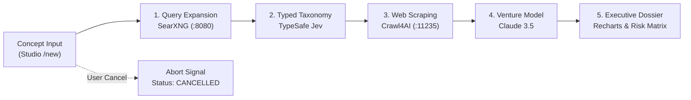

# SIRA — Startup Idea Research Agent

An autonomous venture research and market validation platform. SIRA allows entrepreneurs, venture capitalists, and product builders to stress-test startup concepts with live, multi-source web evidence before writing code.

---

## What SIRA Offers: Executive Dossier Breakdown

Every research task produces an institutional-grade venture dossier backed by primary web evidence. Below is a breakdown of what the platform delivers across its four analytical dimensions:

### 1. Executive Viability & Conviction Assessment
Stress-tests your startup hypothesis against institutional venture frameworks, calculating an overall viability score with sub-metrics for market demand, defensibility, and execution feasibility.



- **Viability Conviction Rating (0–100):** Clear assessment badge (`HIGH CONVICTION`, `MODERATE`, `CAUTION`) calibrated to market realities.
- **Strategic Verdict:** Actionable executive takeaway summarizing the core market opportunity, required turnaround cycles, and key hurdles.
- **Opportunity & Risk Summary:** Qualitative synthesis highlighting timing advantages, critical risks, and moat defensibility.

---

### 2. TAM / SAM / SOM Market Sizing & CAGR Modeling
Quantifies the market opportunity using interactive visual charts and conservative top-down/bottom-up methodologies.



- **Interactive Recharts Bar Visualization:** Clear comparative scale between Total Addressable Market (TAM), Serviceable Addressable Market (SAM), and Serviceable Obtainable Market (SOM).
- **Compound Annual Growth Rate (CAGR):** Projected expansion metrics (e.g., 18.4% CAGR) sourced from industry analyst forecasts.
- **Granular Segment Breakdown:** Dedicated cards for each tier detailing target demographics, geographic reach, and achievable revenue expectations.

---

### 3. Competitor Threat Matrix & Pricing Intelligence
Decomposes the competitive landscape to uncover incumbent pricing, customer complaints, and defensibility moats.



- **Threat Level Badges:** Instant triage of direct vs. indirect competitors (`HIGH`, `MEDIUM`, `LOW`).
- **Pricing Disclosures:** Verified subscription tiers, free-tier limits, and enterprise pricing extracted from real web pricing pages.
- **Strengths vs. Weaknesses:** Balanced audit identifying incumbent vulnerabilities (e.g., alert fatigue, false positives, enterprise lock-in).
- **Differentiation Advantage:** Clear positioning moats that set your venture apart.

---

### 4. Strategic Deep-Dive: 2x2 SWOT Matrix, Customer Friction & Risk Mitigation
Evaluates internal execution factors against external market forces with actionable risk hedges.



- **2x2 SWOT Analysis:** Clean categorization of internal Strengths, internal Weaknesses, external Market Opportunities, and external Competitive Threats.
- **Customer Friction & Unmet Needs:** Verified developer and customer complaints gathered from community discussions (Reddit, Hacker News) with severity ratings and current manual workarounds.
- **Operational Risks & Concrete Mitigations:** Identified failure modes paired side-by-side with verified operational safeguards.

---

### 5. 100% Verified Primary Citations & Web Evidence Base
Every quantitative metric and qualitative claim in the report is tied directly to a verifiable primary source.



- **Real-Time Source Filter:** Instant search through citations by keyword or domain.
- **Direct Anchor Claims:** Verbatim excerpts and statistical claims from primary reports, technical discussions, and press releases.
- **One-Click External Links:** Direct outbound links (`Visit Source ↗`) allowing founders and investors to inspect primary evidence in one click.

---

### 6. Autonomous 4-Stage Pipeline Architecture
SIRA's landing page features an interactive, scroll-driven visualizer showing how the agent coordinates multi-engine search, deterministic classification, headless scraping, and LLM synthesis.



---

## Core Capabilities

1. **Autonomous 4-Stage Research Pipeline:** Metasearch query expansion (SearXNG), typed signal classification (TypeSafe Jev), headless DOM extraction (Crawl4AI), and venture synthesis (Claude 3.5).
2. **Research Lifecycle Management:** Real-time cancellation (`POST /api/research/{id}/cancel`) with active background task aborts, and permanent dossier deletion (`DELETE /api/research/{id}`) with cascade.
3. **Motion-Powered UI & Bespoke Typography:** Hardware-accelerated parallax architectural grid, scroll-linked text reveals, bespoke `Plus Jakarta Sans` and `JetBrains Mono` typography, and frosted glassmorphism with specular highlights.
4. **Multi-Factor Authentication & RBAC:** Two-step signup with Google/Microsoft Authenticator QR code enrollment, TOTP signin, signed JWT tokens, and role-based route protection (`MEMBER` vs `ADMIN`).
5. **Session Draft Persistence & Smart Redirection:** Concept drafts on `/new` persist across unauthenticated sessions; post-login redirects return users directly to their intended destination with form fields restored.

---

## System Architecture & Monorepo Layout


SIRA is structured as a clean monorepo adhering strictly to four distinct zones:

```text
sira/
├── apps/                          # Deployable Frontends
│   └── web/                       # React 19 + Vite + Tailwind CSS + Motion + Recharts SPA
├── services/                      # Deployable Backends
│   ├── api/                       # FastAPI HTTP Gateway (Auth, SSE Streaming, REST Routes)
│   └── agent/                     # Autonomous Workers (SearXNG, Jev Classifier, Crawl4AI, Claude)
├── packages/                      # Shared Stack-Agnostic Libraries
│   ├── models/                    # SQLAlchemy models, Pydantic schemas, and enums
│   ├── lib/                       # Cryptography, security, and TOTP helpers
│   └── db/                        # Neon PostgreSQL async connection & Alembic migrations
├── scripts/                       # Unified Workflow CLI Runner
│   ├── py.js                      # Cross-platform Python venv launcher
│   ├── seed_users.py              # Test user & TOTP seeding script
│   ├── run.ps1                    # PowerShell runner (Windows)
│   └── run.sh                     # Bash runner (macOS / Linux)
├── docs/                          # Documentation & Architecture Specs
│   ├── assets/screenshots/        # High-resolution UI screenshots & evidence
│   └── superpowers/specs/         # Design specifications
├── AGENTS.md                      # AI Agent Ground Rules & Source of Truth
├── alembic.ini                    # Database migration configuration
├── requirements.txt               # Python backend dependencies
└── package.json                   # Root monorepo workspace configuration
```

---

## How the Agent Pipeline Works

When a member submits an idea, SIRA coordinates an autonomous pipeline in a background worker task, streaming live progress back to the user via Server-Sent Events (SSE):



1. **Semantic Query Expansion & Metasearch:** Claude Haiku expands the concept brief into 4 domain-focused search queries (bypassing pre-launch brand name collision); SearXNG queries Google, Bing, and DuckDuckGo across orthogonal angles, gathering and deduplicating 20+ sources with domain diversity caps.
2. **Signal Classification:** TypeSafe AI's Jev model evaluates each search result against 12 granular categories (`competitors`, `market_size`, `pain_points`, `pricing_models`) and discards off-target noise.
3. **Headless Scraping:** Crawl4AI headlessly renders the top balanced pages inside Docker, stripping cookie banners and navigation noise into clean Markdown.
4. **Venture Synthesis:** Anthropic Claude Sonnet 4.5 evaluates the evidence base as a venture capital analyst, computing TAM/SAM/SOM market ceilings, competitor threat matrices, and viability scores (0-100) with citations.
5. **Interactive Visualization:** The web dashboard renders dynamic Recharts bar charts, SWOT grids, risk mitigation tables, and clickable source links.

---

## Prerequisites

- **Node.js:** v20+ with `pnpm` (`corepack enable pnpm` or `npm install -g pnpm`)
- **Python:** v3.12+ (configured in `.venv`)
- **Docker Desktop:** Running locally for SearXNG and Crawl4AI
- **PostgreSQL Database:** Neon Serverless Postgres (or any Postgres instance)
- **API Keys:** Anthropic API key and TypeSafe AI API key

---

## Step-by-Step Setup Guide

### 1. Start External Docker Microservices

#### Windows PowerShell:
```powershell
# 1. Start SearXNG Metasearch (runs on port 8080)
mkdir -p "$HOME\searxng"
@"
use_default_settings: true
server:
  secret_key: "searxng_secret_key_123"
  limiter: false
search:
  formats:
    - html
    - json
"@ | Set-Content -Path "$HOME\searxng\settings.yml"

docker run -d --name searxng -p 8080:8080 -v "${HOME}\searxng:/etc/searxng" searxng/searxng:latest

# 2. Start Crawl4AI Headless Scraper (runs on port 11235)
docker run -d --name crawl4ai -p 11235:11235 -e CRAWL4AI_API_TOKEN=crawl4ai_secret_123 --shm-size=1g unclecode/crawl4ai:latest
```

#### macOS / Linux (POSIX Bash):
```bash
# 1. Start SearXNG Metasearch (runs on port 8080)
mkdir -p ~/searxng
cat << 'EOF' > ~/searxng/settings.yml
use_default_settings: true
server:
  secret_key: "searxng_secret_key_123"
  limiter: false
search:
  formats:
    - html
    - json
EOF

docker run -d --name searxng -p 8080:8080 -v "$HOME/searxng:/etc/searxng" searxng/searxng:latest

# 2. Start Crawl4AI Headless Scraper (runs on port 11235)
docker run -d --name crawl4ai -p 11235:11235 -e CRAWL4AI_API_TOKEN=crawl4ai_secret_123 --shm-size=1g unclecode/crawl4ai:latest
```

---

### 2. Configure Environment Variables

Create `.env` in the repository root:

```env
# Database (Neon PostgreSQL)
DATABASE_URL=postgresql+asyncpg://<username>:<password>@<neon-host>/neondb?ssl=require
SYNC_DATABASE_URL=postgresql+psycopg2://<username>:<password>@<neon-host>/neondb?ssl=require

# Security & JWT
JWT_SECRET_KEY=your_super_secret_jwt_key_here
JWT_ALGORITHM=HS256
ACCESS_TOKEN_EXPIRE_MINUTES=1440

# AI Services
ANTHROPIC_API_KEY=sk-ant-api03-...
TYPESAFE_API_KEY=your_typesafe_key_here

# Microservices
SEARXNG_URL=http://localhost:8080
CRAWL4AI_URL=http://localhost:11235
CRAWL4AI_API_TOKEN=crawl4ai_secret_123
```

---

### 3. Install Dependencies & Apply Migrations

```bash
# 1. Install workspace dependencies
pnpm install

# 2. Apply Alembic database migrations to Neon PostgreSQL
pnpm db:migrate
```

---

### 4. Seed Test Accounts (Admin & Member)

Seed pre-configured accounts with pre-shared TOTP credentials:

```bash
pnpm db:seed
```

| Role | Email | Password | Pre-shared TOTP Secret |
| :--- | :--- | :--- | :--- |
| **Admin** | `admin@startup.com` | `AdminPassword123!` | `JBSWY3DPEHPK3PXP` |
| **Member** | `member@startup.com` | `MemberPassword123!` | `JBSWY3DPEHPK3PXP` |

> *Tip: In Google Authenticator or Microsoft Authenticator, tap **"Add Account"** &rarr; **"Enter a setup key"**, enter `JBSWY3DPEHPK3PXP`, and name it "SIRA Test".*

---

### 5. Run the Application

#### Single Terminal Runner (Recommended):
```bash
pnpm dev
```
Runs the FastAPI Backend (`:8000`) and the Vite React Frontend (`:5173`) concurrently.

#### Or Separate Terminals:
```bash
# Terminal 1: FastAPI Backend
pnpm dev:api

# Terminal 2: React Frontend
pnpm dev:web
```

- **Web Application:** `http://localhost:5173`
- **FastAPI Documentation:** `http://localhost:8000/docs`

---

## API Endpoints Reference

| Method | Endpoint | Access | Purpose |
| :--- | :--- | :--- | :--- |
| `POST` | `/auth/signup/step1` | Public | Initiates registration; returns base64 QR code and TOTP secret |
| `POST` | `/auth/signup/step2` | Public | Verifies initial 6-digit TOTP code; marks user verified |
| `POST` | `/auth/signin` | Public | Validates email, password, and TOTP code; returns JWT |
| `GET` | `/auth/me` | Authenticated | Retrieves current user profile & role |
| `POST` | `/research/start` | Member / Admin | Queues idea in background tasks; returns `research_id` |
| `GET` | `/research/{id}/stream` | Member / Admin | Real-time Server-Sent Events (SSE) progress streaming |
| `POST` | `/research/{id}/cancel` | Member / Admin | Aborts running background worker task and marks as `cancelled` |
| `DELETE` | `/research/{id}` | Member / Admin | Permanently deletes dossier record and associated data |
| `GET` | `/research/{id}` | Member (Own) / Admin | Fetches complete synthesized dossier report JSON |
| `GET` | `/research/history` | Member / Admin | Lists past research reports for current user |
| `GET` | `/research/admin/all` | Admin Only | Lists all research projects across all platform users |

---

## License & Attribution

Developed with Google DeepMind Antigravity agentic workflows. Distributed under the MIT License.
