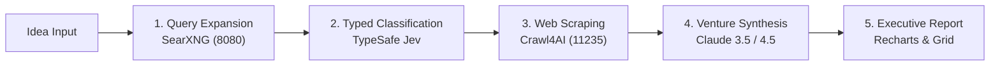

# SIRA — Startup Idea Research Agent

An autonomous venture research and market validation platform. SIRA allows entrepreneurs and investors to stress-test startup concepts before building. 

The application is composed of two end-to-end halves:
1. **Secure Multi-Factor Authentication & RBAC:** Two-step signup with live Google/Microsoft Authenticator QR code enrollment, signin with 6-digit TOTP codes, signed JWT access tokens, and role-based route protection (`MEMBER` vs `ADMIN`).
2. **Autonomous AI Research Subsystem:** Real-time query expansion, metasearch aggregation, typed signal classification, headless page scraping, and venture validation synthesized by Claude into interactive Recharts visualizations.

---

## Architecture & Monorepo Layout

SIRA is structured as a monorepo adhering strictly to four distinct zones:

```text
sira/
├── apps/                          # Deployable Frontends
│   └── web/                       # React 19 + Vite + Tailwind CSS + Recharts SPA
├── services/                      # Deployable Backends
│   ├── api/                       # FastAPI HTTP Gateway (Auth, SSE Streaming, Routes)
│   └── agent/                     # Autonomous Research Workers (Search, Classifier, Scraper, Claude)
├── packages/                      # Shared Stack-Agnostic Libraries
│   ├── models/                    # SQLAlchemy models & Pydantic schemas
│   ├── lib/                       # Security, cryptography, and TOTP helpers
│   └── db/                        # Neon PostgreSQL connection & Alembic migrations
├── scripts/                       # Unified Workflow CLI Runner (run.ps1 / run.sh)
│   ├── run.ps1                    # PowerShell runner (Windows)
│   ├── run.sh                     # Bash runner (macOS / Linux)
│   └── seed_users.py              # Test user & TOTP seeding script
├── docs/                          # Documentation & Architecture Specs
│   ├── file-structure.md          # In-depth file catalog
│   └── superpowers/specs/         # Design specifications
├── AGENTS.md                      # AI Agent Ground Rules & Source of Truth
├── alembic.ini                    # Database migration configuration
├── requirements.txt               # Python backend dependencies
└── package.json                   # Root monorepo workspace configuration
```

---

## How the Agent Pipeline Works

When a member submits an idea, SIRA executes a 4-stage pipeline in a background worker task, streaming live progress back to the user via Server-Sent Events (SSE):



1. **Query Expansion & Search:** SearXNG metasearch searches Google, Bing, and DuckDuckGo across 3 distinct angles (competitors, market size, and customer friction), gathering and deduplicating 15+ links.
2. **Classification:** TypeSafe AI's Jev model evaluates each search result against 12 granular categories (`competitors`, `market_size`, `pain_points`, `pricing_models`, etc.) and filters out irrelevant noise.
3. **Scraping:** Crawl4AI renders the top 6 balanced pages using headless Chromium inside Docker, extracting clean markdown text.
4. **Venture Synthesis:** Anthropic Claude analyzes the scraped evidence as a Silicon Valley venture partner, returning structured JSON with a decisive verdict, 0-100 viability score, TAM/SAM/SOM sizing, competitor threat matrix, SWOT analysis, and citations.
5. **Interactive Visualization:** The web dashboard renders the report with dynamic Recharts bar charts, risk mitigation tables, and clickable source links.

---

## Prerequisites

- **Node.js:** v20+ with `pnpm`
- **Python:** v3.12+
- **Docker Desktop:** Running locally for SearXNG and Crawl4AI
- **PostgreSQL Database:** Neon Serverless Postgres (or any Postgres instance)
- **API Keys:** Anthropic API key and TypeSafe AI API key

---

## Quick Start Setup Guide

### 1. Start External Docker Containers

Start the local SearXNG and Crawl4AI services:

```powershell
# 1. SearXNG Metasearch (runs on port 8080)
mkdir -p ~/searxng
@"
use_default_settings: true
server:
  secret_key: "searxng_secret_key_123"
  limiter: false
search:
  formats:
    - html
    - json
"@ | Set-Content -Path "$HOME\searxng\settings.yml"

docker run -d --name searxng -p 8080:8080 -v "${HOME}\searxng:/etc/searxng" searxng/searxng:latest

# 2. Crawl4AI Headless Scraper (runs on port 11235)
docker run -d --name crawl4ai -p 11235:11235 -e CRAWL4AI_API_TOKEN=crawl4ai_secret_123 --shm-size=1g unclecode/crawl4ai:latest
```

### 2. Configure Environment Variables

Create `.env` and `services/api/.env`:

```env
# Database (Neon Postgres)
DATABASE_URL=postgresql+asyncpg://<username>:<password>@<neon-host>/neondb?ssl=require
SYNC_DATABASE_URL=postgresql+psycopg2://<username>:<password>@<neon-host>/neondb?ssl=require

# Security & JWT
JWT_SECRET_KEY=your_super_secret_jwt_key_here
JWT_ALGORITHM=HS256
ACCESS_TOKEN_EXPIRE_MINUTES=1440

# AI Services
ANTHROPIC_API_KEY=sk-ant-...
TYPESAFE_API_KEY=...

# Local Docker Microservices
SEARXNG_URL=http://localhost:8080
CRAWL4AI_URL=http://localhost:11235
CRAWL4AI_API_TOKEN=crawl4ai_secret_123
```

### 3. Install Dependencies & Run Database Migrations

```bash
# Install Node dependencies
pnpm install

# Apply Alembic database migrations to Neon Postgres
pnpm db:migrate
```

### 4. Seed Test Users (Admin & Member)

Seed pre-configured accounts with pre-shared TOTP secrets:

```bash
pnpm db:seed
```

| Account Role | Email | Password | Pre-shared TOTP Secret |
| :--- | :--- | :--- | :--- |
| **Admin** | `admin@startup.com` | `AdminPassword123!` | `JBSWY3DPEHPK3PXP` |
| **Member** | `member@startup.com` | `MemberPassword123!` | `JBSWY3DPEHPK3PXP` |

> *Tip: In Google Authenticator or Microsoft Authenticator, tap "Add Account" &rarr; "Enter a setup key", enter `JBSWY3DPEHPK3PXP`, and name it "SIRA Test".*

---

## Running the Application with pnpm

You can run both services concurrently in a single terminal with `pnpm`:

```bash
pnpm dev
```
This runs the FastAPI API (`:8000`) and the Vite React frontend (`:5173`) side-by-side using `concurrently`.

### Or Run in Separate Terminals:

#### Terminal 1: Start FastAPI Backend
```bash
pnpm dev:api
```
Backend API will be live at: **`http://localhost:8000`**  
Interactive Swagger docs: **`http://localhost:8000/docs`**

#### Terminal 2: Start React Frontend
```bash
pnpm dev:web
```
Web Application will be live at: **`http://localhost:5173`**

### Alternative Shell Runners:
You can also run commands via the CLI runner scripts:
- Windows PowerShell: `.\scripts\run.ps1 dev`, `.\scripts\run.ps1 dev:api`, `.\scripts\run.ps1 dev:web`
- POSIX Bash: `./scripts/run.sh dev`, `./scripts/run.sh dev:api`, `./scripts/run.sh dev:web`

---

## API Endpoints Reference

| Method | Endpoint | Access | Purpose |
| :--- | :--- | :--- | :--- |
| `POST` | `/auth/signup/step1` | Public | Initiates registration; returns base64 QR code and TOTP secret |
| `POST` | `/auth/signup/step2` | Public | Verifies first 6-digit TOTP code; sets user as verified |
| `POST` | `/auth/signin` | Public | Validates email, password, and TOTP code; returns JWT |
| `GET` | `/auth/me` | Authenticated | Retrieves signed-in user profile & role |
| `POST` | `/research/start` | Member / Admin | Queues idea in background tasks; returns `research_id` |
| `GET` | `/research/{id}/stream` | Member / Admin | Real-time Server-Sent Events (SSE) streaming progress |
| `GET` | `/research/{id}` | Member (Own) / Admin | Fetches completed report JSON |
| `GET` | `/research/history` | Member / Admin | Lists past research reports for current user |
| `GET` | `/research/admin/all` | Admin Only | Lists all research projects across all platform users |
